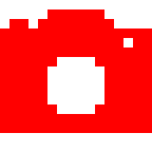
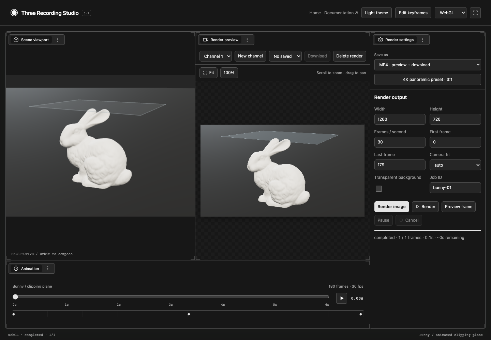

# Three Recording Studio

A render workspace for existing Three.js scenes: exact frame timing, independent output framing, a themed preview panel, image sequences with recovery, and browser MP4 export.



**Pre-release.** The repository is runnable; the package is not yet published to npm.

```sh
npm ci
npm run build
npm run dev
```

Open http://127.0.0.1:5190. Select Demo to open `/demo`. The demo uses Quilt panes and a Theatre.js keyframed scene. Switch between WebGL and WebGPU in the header. The render panel and library itself do not require either framework.

```sh
npm run receiver -- --directory ./recordings
```

Select PNG sequence in the demo and paste the receiver token. Interrupted jobs can resume when the scene identity and settings match. For MP4, select browser download; Mediabunny handles encoding.

## Architecture

- `RenderSession`: exclusive lifecycle and frame scheduling.
- `WebGLCaptureAdapter` / `WebGPUCaptureAdapter`: offscreen targets and awaited readback.
- `RenderPanel`: DOM/CSS UI, fixed functional layout, theme tokens, floating or embedded views.
- `WebSocketDestination`: acknowledged, resumable PNG saving.
- `Mp4Destination`: browser H.264 export with an output-memory ceiling.

Applications provide animation acquisition, timestamp evaluation, readiness and restoration hooks. Passing a clock alone cannot ensure correct export. Source scenes must be seekable for durable resume. Postprocessing uses an explicit integration hook.

See [the guide](tools/docs/docs/guide.md), [API](tools/docs/docs/api.md), [rendering contract](tools/docs/docs/rendering.md), and [saving](tools/docs/docs/saving.md). Run `npm run docs:dev` for the styled documentation.

## Development

Node 24+. Three.js 0.186.x. ESM and strict TypeScript.

```sh
npm run check
npm run test:browser
npm pack
```

Browser tests require installed Google Chrome with native WebGPU available. The local receiver tests require loopback sockets. No unavailable GPU test is silently skipped.

The built core/UI entry points do not import the encoding entry point; consumers can omit optional dependencies if they only need PNG output. The standalone receiver is included as `three-recording-receiver`.

MIT license. Mediabunny retains its MPL-2.0 license. Three.js, Quilt and Theatre retain their respective licenses.

## Static site

`npm run build:site` produces `site/` with the introduction at `/`, documentation pages at `/guide` and `/api`, and the demo at `/demo`. Run `npm run preview:site`, then `npm run test:site` to check the built site. `npm run dev` starts both development servers and serves the introduction and documentation on port 5190, with `/demo` proxied to the demo server.

`npm run test:packed` installs the package archive into a temporary clean consumer and verifies core/UI imports without optional encoding dependencies or demo frameworks.

See [validation results](VALIDATION.md) for tested behavior and release boundaries.
